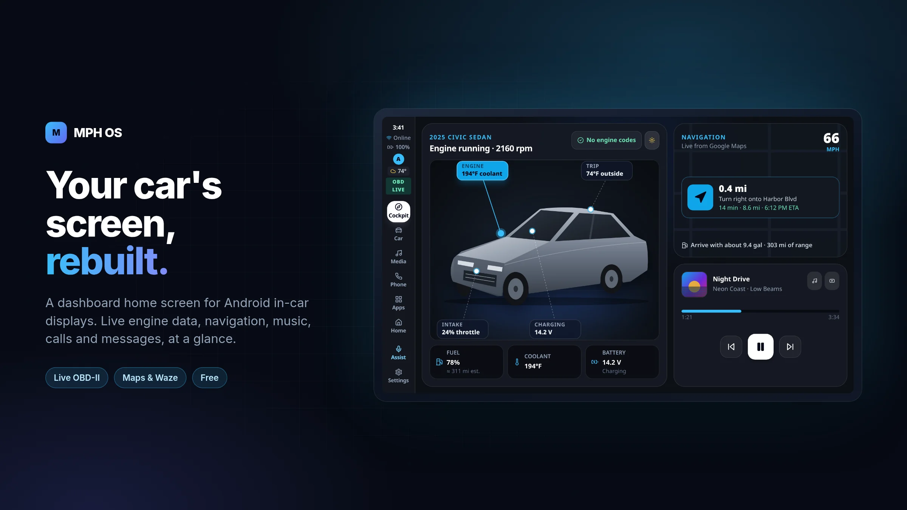
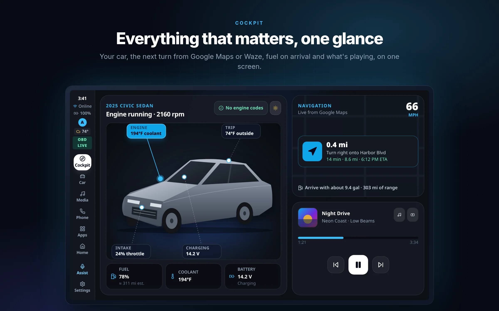
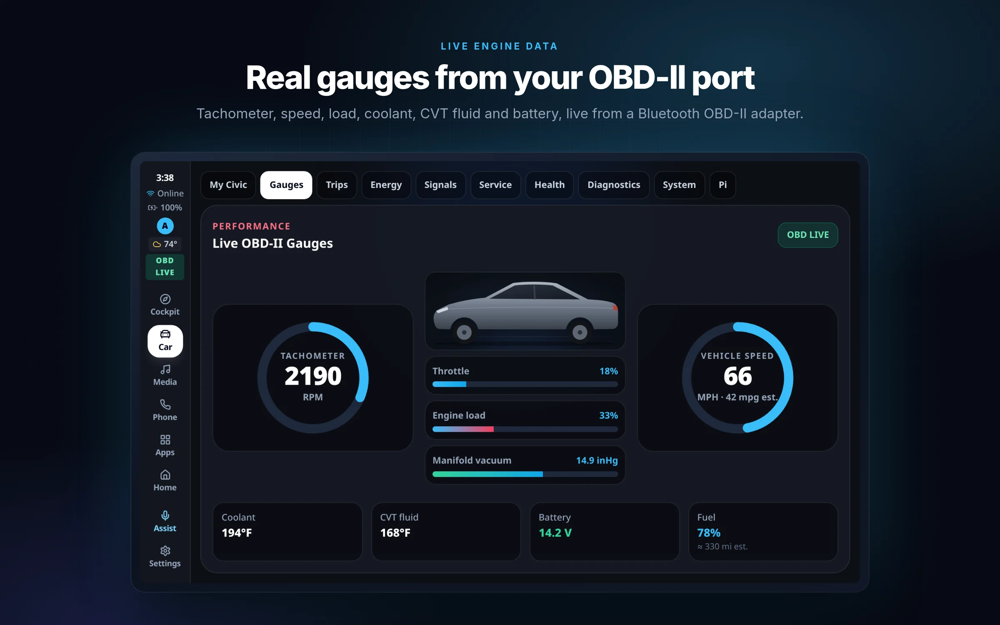
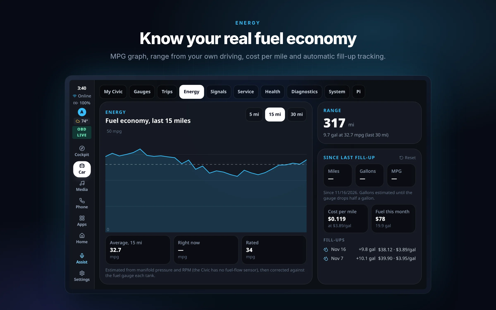
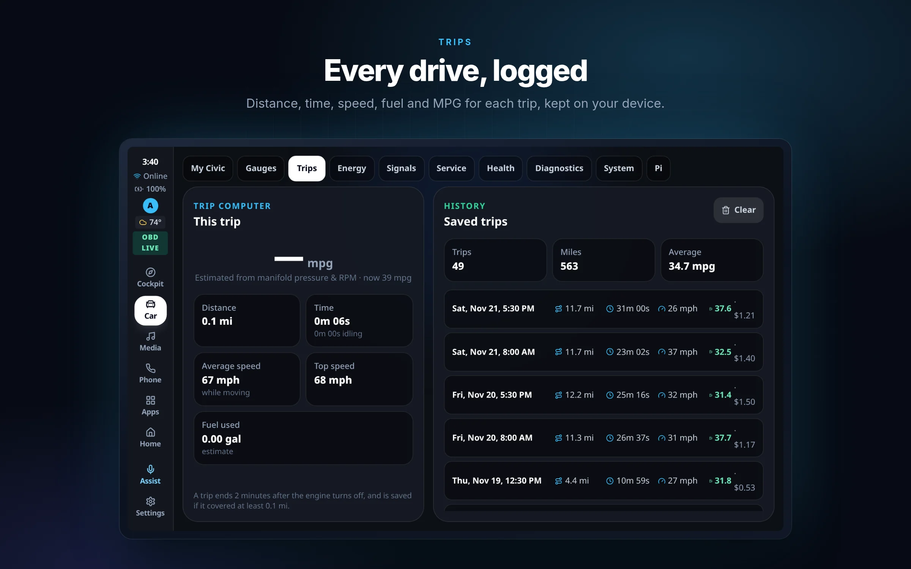
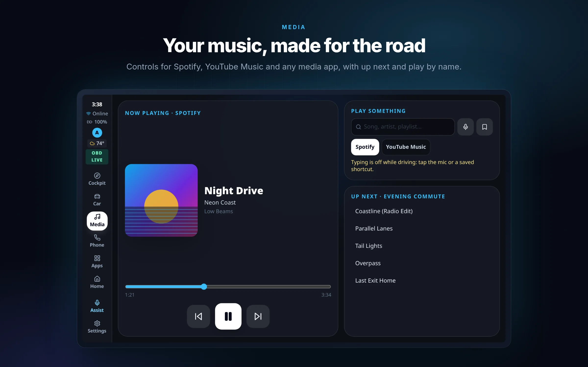
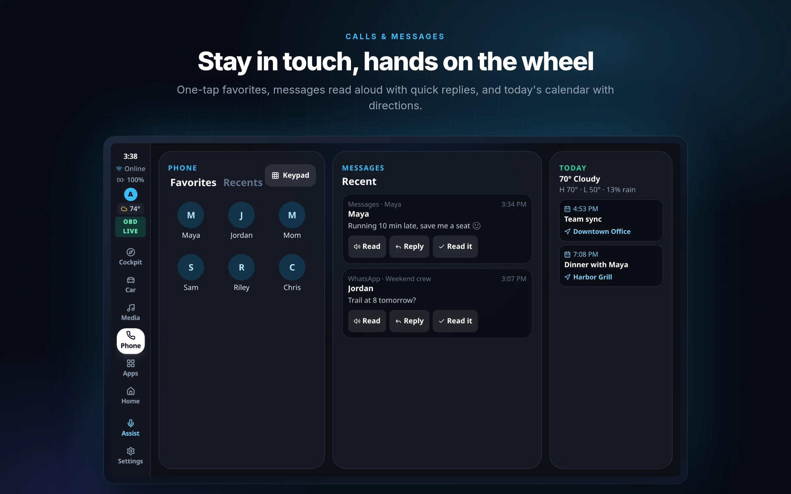
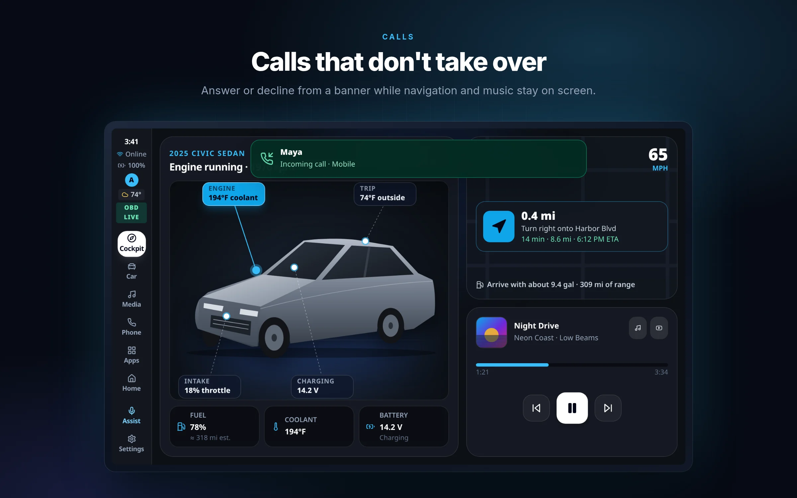
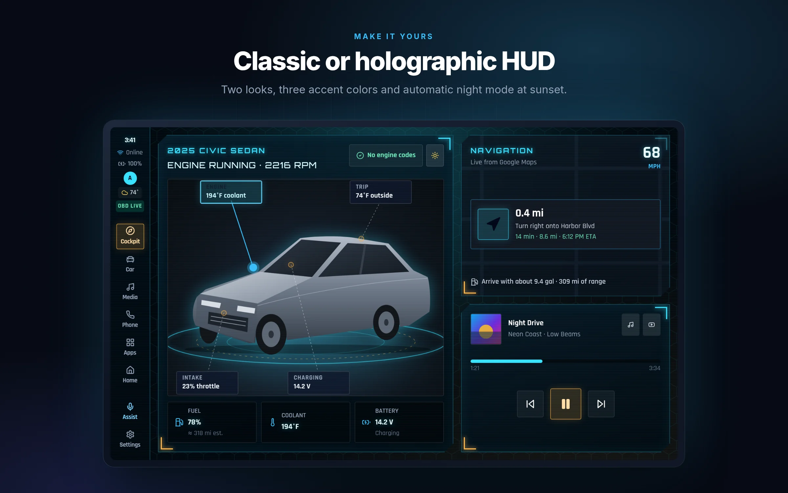

# MPH OS

**A dashboard home screen for Android in-car displays.** 
Live engine data, navigation, music, calls and messages, at a glance.

[**Download the APK**](../../releases/latest) · [Features](#features) · [Install](#install) · [Coming soon](#coming-soon) · [FAQ](#faq)

---

MPH OS turns an Android head unit, tablet or in-car Android setup into a purpose-built car dashboard. Set it
as your Home app and it becomes the screen you drive with: your car's live data, the next turn from Google Maps
or Waze, what's playing and who's messaging, all sized for a glance.

It was built for a **2025 Honda Civic** and works on any Android 7+ device. Honda-specific engine signals work
best on 11th-generation Civics (2022+); standard OBD-II data works on any car from 1996 on.

> **Early release.** Expect rough edges and send feedback through [Issues](../../issues).

## Features

### Everything that matters, one glance
The Cockpit puts your car, the live next turn from Google Maps or Waze, fuel left on arrival and what's playing
on one screen, so you rarely need to switch apps while driving.

### Real gauges from your OBD-II port
Tachometer, speed, engine load, throttle, coolant, CVT fluid and battery, live from a Bluetooth OBD-II adapter.
Trouble codes and readiness monitors are a tap away, and alerts pop up if something runs hot.

<table>
<tr>
<td width="50%"> <b>Know your real fuel economy.</b> MPG graph, range from your own driving, cost per mile and automatic fill-up tracking.</td>
<td width="50%"> <b>Every drive, logged.</b> Distance, time, speed, fuel and MPG for each trip, kept on your device.</td>
</tr>
<tr>
<td width="50%"> <b>Your music, made for the road.</b> Controls for Spotify, YouTube Music and any media app, with up next and play by name.</td>
<td width="50%"> <b>Stay in touch, hands on the wheel.</b> One-tap favorites, messages read aloud with quick replies, today's calendar with directions.</td>
</tr>
<tr>
<td width="50%"> <b>Calls that don't take over.</b> Answer or decline from a banner while navigation and music stay on screen.</td>
<td width="50%"> <b>Make it yours.</b> Classic or holographic HUD style, three accent colors and automatic night mode at sunset.</td>
</tr>
</table>

### And more
- **Split screen:** Maps or Waze beside a slim MPH OS panel with speed, next turn, fuel on arrival and music.
- **Learned destinations:** one-tap Home, Work and favorites, plus "Heading to…?" suggestions from when you usually go.
- **Driver profiles:** each driver's places, look and preferences switch automatically when their phone connects.
- **Driving mode:** Do Not Disturb while moving (starred contacts still get through); video and typing are locked until you park.
- **Car health:** battery, charging, warm-up, fuel trims and trouble codes rated Good / Watch / Check over your drives.
- **Service tracker:** oil life and maintenance countdowns from your mileage.
- **Demo mode:** try everything with sample data, no car or adapter needed.

## Install

1. Download the latest `mph-os-<version>.apk` from [**Releases**](../../releases/latest).
2. Open it on your Android device and allow installs from your browser or file manager.
3. Optional: set MPH OS as your **Home app** so it opens when the screen turns on.

**What you need**
| | |
|---|---|
| Device | Android 7 or newer: head unit, tablet or in-car Android setup |
| Live car data (optional) | ELM327-compatible **Bluetooth Classic** OBD-II adapter, e.g. OBDLink MX+ or LX. BLE-only adapters aren't supported yet. |
| Next turn and messages | Notification access, asked the first time you use them |

**Updates:** Settings → Updates checks this page for new versions. Android always asks before installing.

## Coming soon

Planned for upcoming releases. Plans can change.

- **Always-on essentials:** next turn and now playing pinned to the dock on every screen.
- **Moving vs parked layouts:** bigger targets and fewer choices while driving.
- **Customizable dock:** drag to reorder and pin your favorite apps and actions.
- **Universal search:** settings, apps, contacts and places in one box.
- **Widgets:** your favorite apps' widgets on the Cockpit.
- **Weather radar** with the past hour of rain.
- **Speed camera alerts.**
- **Drive summary** when you park: distance, time, fuel and MPG against your average.
- **Smarter suggestions:** the call, music or place you usually pick at this time.

## FAQ

**Does it work with my car?** The app runs on any Android 7+ screen. Standard OBD-II data (speed, RPM, coolant,
fuel and more) works with most cars from 1996 on. Extra Honda signals such as CVT fluid temperature are tuned for
11th-generation Civics.

**Does it replace Android Auto or CarPlay?** It's a home screen for Android screens in the car. It doesn't run
inside Android Auto or CarPlay.

**What data does it collect?** None leaves your device: trips, fuel history and settings are stored locally.
Weather uses your approximate location with Open-Meteo; updates are checked against this GitHub page.

**Is the code open source?** Not at the moment. This repository hosts the releases.

## Support

MPH OS is free. If it makes your drive better, you can support development on
**[Ko-fi](https://ko-fi.com/alexgalicea)** ☕

## Safety and license

Set things up while parked and keep your eyes on the road. Engine values come from your car's diagnostic data and
may be wrong or late; don't rely on them for safety.

Free for personal, non-commercial use under the [MPH OS End-User License](LICENSE.md). Not affiliated with or
endorsed by Honda, Apple or Google. Screenshots show sample data.
