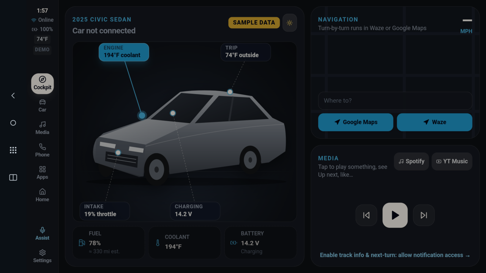

# MPH OS

A custom in-car home screen for Android: a cockpit with live engine data, navigation shortcuts, media,
calls and messages, built for the car's own display.

MPH OS was made for a **2025 Honda Civic** running Android on the car screen through
[Pi2Carplay](https://github.com/Fotsbeats/Pi2Carplay). It runs on any Android 7+ device as a launcher, and
its Honda-specific engine signals work best on 11th-generation Civics (2022+).

> **Early release.** Expect rough edges. Code is not public; this repository hosts the app releases only.

## Features

- Cockpit: live coolant, battery, fuel, intake and trip data on a tappable car view; check-engine status.
- Car: gauges, trip computer and history, diagnostics (trouble codes, readiness), service tracker.
- Navigation shortcuts (Google Maps, Waze) and next-turn display; media controls (Spotify, YouTube Music).
- Calls and messages with read-aloud and quick replies.
- Classic and holographic HUD styles, night mode, driving lock (video and typing blocked while moving).
- Demo mode with sample data: no car or adapter needed to try it.

## Install

1. Download the latest `mph-os-<version>.apk` from [Releases](../../releases/latest).
2. Open it on your Android device and allow installs from your browser or file manager.
3. Optional: set MPH OS as your Home app.

Live car data needs an ELM327-compatible OBD-II adapter. Bluetooth Classic adapters such as OBDLink MX+ or LX
work directly; BLE-only adapters don't.

**Updates:** Settings → Updates checks this page for new versions. Android always asks before installing.

## Support

MPH OS is free. If it makes your drive better, you can support development on
**[Ko-fi](https://ko-fi.com/alexgalicea)** ☕

## Safety and license

Set things up while parked and keep your eyes on the road. Engine values come from your car's diagnostic data
and may be wrong or late; don't rely on them for safety.

Free for personal, non-commercial use under the [MPH OS End-User License](LICENSE.md). Not affiliated with or
endorsed by Honda, Apple or Google.
